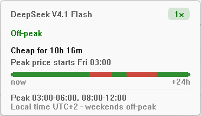
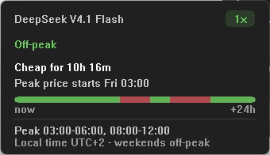

# DeepPeak

A tiny Windows tray app that tells you when **DeepSeek V4.1 Flash** is billed at
peak or off-peak rates, and how long you have left in the current tier.

Built for people running DeepSeek V4.1 Flash through **OpenCode Go** and
**CommandCode GOAT**, both of which pass through DeepSeek's time-of-day pricing.
Working off-peak roughly doubles how far your monthly credits go.


| Light | Dark |
|---|---|
|  |  |

## Download and install

1. Open [Releases](https://github.com/theacidblack/DeepPeak/releases).
2. Download `DeepPeak-1.0.0-setup.exe`.
3. Run it. No admin rights, no reboot, no dependencies.

It installs per user into `%LOCALAPPDATA%\Programs\DeepPeak`, adds a Start Menu
entry, and offers "Start with Windows" and a desktop shortcut during setup. The
app appears in the tray.

Verify the download if you like:

```powershell
Get-FileHash .\DeepPeak-1.0.0-setup.exe -Algorithm SHA256
```

The hash is published in the release notes and in `dist\SHA256.txt` next to the
installer.

> **Windows only for now.** The app is written directly against Win32 and the
> Windows tray. macOS and Linux ports are feasible (menu bar item plus the same
> clock math) but not written yet -- ask nicely and it can happen.

## Why it matters

Peak tokens cost exactly **2x** off-peak tokens. Both subscriptions meter you in
dollars (a monthly pool plus rolling 5-hour and weekly windows), so a peak
session burns the pool twice as fast.

| | Off-peak | Peak |
|---|---|---|
| Input / output per 1M | $0.15 / $0.60 | $0.30 / $1.20 |
| Effective usage | 100% | ~50% |

**Peak: 01:00-04:00 and 06:00-10:00 UTC, Monday-Friday.** Everything else,
including the whole weekend, is off-peak: 17 h per weekday and all 48 h of the
weekend.

## Works in any time zone

Every calculation is done in UTC; local time is only used for display, through
the Windows time zone database. So it is correct in every country, including
half-hour offsets (UTC+5:30), and summer time is handled automatically.

In Kyiv (UTC+2) the peak windows land at 03:00-06:00 and 08:00-12:00, and shift
to 04:00-07:00 and 09:00-13:00 in summer.

## What you get

- **Tray status**: green dot when off-peak, red when peak, tooltip with the
  countdown.
- **Panel** (click the tray icon): current tier, time left in it, what happens
  next and at which local time, and a 24-hour strip showing the shape of the day.
  It always opens in the bottom-right corner of the main screen, above the
  taskbar, on every screen layout.
- **Popup on every price switch**: the panel appears for ten seconds when the
  tier changes, together with the voice clip, then goes away again.
- **Voice notification** when the price switches ("cheap" / "expensive").
  Toggle it in the tray menu; the choice is remembered.
- **Ctrl+D, then P** anywhere in Windows to show or hide the panel.
- **X in the panel header** closes the panel. The app keeps running in the
  tray; quit it from the tray menu (`Exit`).
- Light and dark themes that follow Windows automatically.
- Start with Windows, on or off, from the tray menu.

## What it does not do

No telemetry, no analytics, no network requests, no auto-updater, no background
service, no driver, no admin rights. It reads the system clock and a couple of
registry values, and that is all.

## Uninstall and leftovers

Uninstall from **Settings > Apps > DeepPeak**, from the Start Menu entry, or by
running `Uninstall.exe /S`. A running copy is closed first.

| Created by the installer | Removed on uninstall |
|---|---|
| `%LOCALAPPDATA%\Programs\DeepPeak` (exe, sounds, LICENSE, uninstaller) | yes, whole folder |
| Start Menu folder and shortcuts | yes |
| Optional desktop shortcut | yes |
| `HKCU\Software\Microsoft\Windows\CurrentVersion\Uninstall\DeepPeak` | yes |
| `HKCU\Software\Microsoft\Windows\CurrentVersion\Run\DeepPeak` | yes |
| `HKCU\Software\DeepPeak` (sound preference) | yes |

Nothing is written anywhere else: no `%APPDATA%` folder, no temp files, no
services, no scheduled tasks. Uninstalling leaves the machine as it was. This is
covered by an automated round trip: install, run, uninstall while running,
verify every file and key is gone.

## SmartScreen and reputation

> **Signing status:** application submitted to **SignPath Foundation** on
> 2026-11-12, awaiting review. Details and the plan after approval are in
> [docs/signing.md](docs/signing.md).

An unsigned installer downloaded from the internet will usually trigger
Microsoft Defender SmartScreen ("Windows protected your PC"). That is not a virus
warning, it is a trust warning: the file has no known publisher and no download
reputation yet. Users can proceed with **More info -> Run anyway**, but nobody
likes doing that.

What actually removes the warning, in order of cost:

1. **EV code signing certificate** (~$250-500/year). Extended Validation
   certificates get SmartScreen trust immediately, no reputation wait.
2. **OV code signing certificate** (~$150-300/year). The warning stays at first
   and fades as downloads accumulate; reputation is per certificate, so it
   carries over to future versions.
3. **Azure Trusted Signing** (~$10/month). Much cheaper, but requires an
   organisation with a few years of verifiable history; not available to
   individuals.
4. **SignPath Foundation** - free code signing for open source projects. Real
   certificate, OV-level reputation, so the warning fades with downloads.
   **Applied 2026-11-12, pending review.**
5. **Microsoft Store / MSIX** distribution. Store-signed packages install with no
   SmartScreen prompt at all, at the cost of Store review and packaging.
6. **winget** (`winget install DeepPeak`). Not a signature, but it gives users a
   trusted install path and a verified hash, which greatly reduces hesitation.

Until one of those is in place, the honest answer is: the binary is unsigned, the
source is public, the hash is published, and the app has no network access at
all. Publishing the SHA256 and the full source is the best available substitute
for a signature.

## Verified behaviour

Every minute from 2025-01-01 for three years (1,576,800 minutes) is compared
against an independent implementation of the published rule, plus 10,080
transition checks and 10 boundary cases. `DeepPeak.exe --selftest` reproduces the
result and exits 0.

The window itself is covered separately by `tools\test-live.ps1`: the tray text
must advance every minute, and must never go backwards. That test exists because
the clock-driven updates (countdown, icon colour, voice clip, popup) hang off a
single one-second timer, and arithmetic tests cannot see a timer that never
started.

- Per-user install, no elevation prompt.
- Uninstall while the app is running: the app is asked to quit, then everything
  is removed.
- Settings survive upgrades; uninstall removes them.
- Panel renders correctly at 100-200% DPI, light and dark.

## Build from source

Requirements: Visual Studio Build Tools (MSVC + Windows SDK) and NSIS 3.

```powershell
.\build.ps1                  # app only  -> build\DeepPeak.exe
.\build-installer.ps1        # app + installer -> dist\DeepPeak-1.0.0-setup.exe
```

`build-installer.ps1` also prints the SHA256 of the installer.

Layout:

```
src/main.cpp        entire application (single file, Win32)
app.rc              icon + version resource
app.ico             generated icon
sounds/             peak.mp3 and offpeak.mp3 voice clips
installer.nsi       NSIS installer and uninstaller
build.ps1           app build
build-installer.ps1 app + installer build
tools/              icon generator and screenshot helper
```

## Development helpers

- `tools\capture.ps1 -Theme dark|light` starts the app, opens the panel and
  saves a screenshot to `docs\`.
- `DEEPPEAK_THEME=light|dark` forces a palette.
- `DEEPPEAK_DEBUG=1` writes `%TEMP%\DeepPeak.log` with hook and theme events.
- `DeepPeak.exe --selftest` runs 1.5M minute checks plus transition and boundary
  tests, writes `%TEMP%\DeepPeak-selftest.txt`, exits 0 on pass.
- `tools\test-live.ps1` starts the app and samples the tray tooltip for two
  minutes, failing if the countdown does not move. It catches a dead timer,
  which the pure-math self-test cannot see.
- `DeepPeak.exe --test-sound` plays the notification for the current state.
- `DeepPeak.exe --test-popup` shows the panel for ten seconds, like a price
  switch does.
- `DeepPeak.exe --quit` closes a running copy.

## Memory

Measured on Windows 11, idle, after a few hours:

- Task Manager "Memory" (private working set): ~1.6 MB
- Private commit: ~2.5 MB
- Working set including shared DLLs: ~11-15 MB

The working set number is larger only because the process maps the same Windows
libraries every app uses (`user32`, `gdi32`, `shell32`, `winmm`, `dwmapi`); those
pages are shared and are not extra RAM the system gives up for this app.

One 1-second timer, no threads of its own, no network.

## Third-party resources

- Voice clips generated with **text-to-speech.online** -
  <https://www.text-to-speech.online/en/>. Free online TTS used to record the two
  notification lines.

## License

MIT. See [LICENSE](LICENSE).
